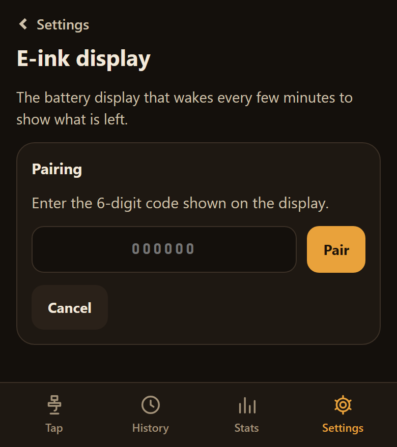
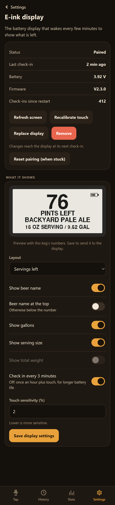
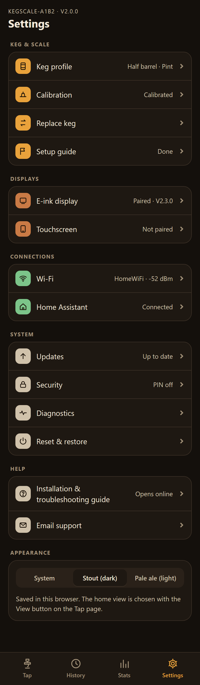
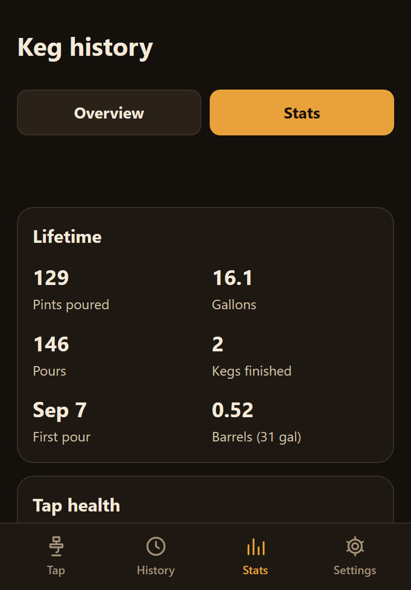
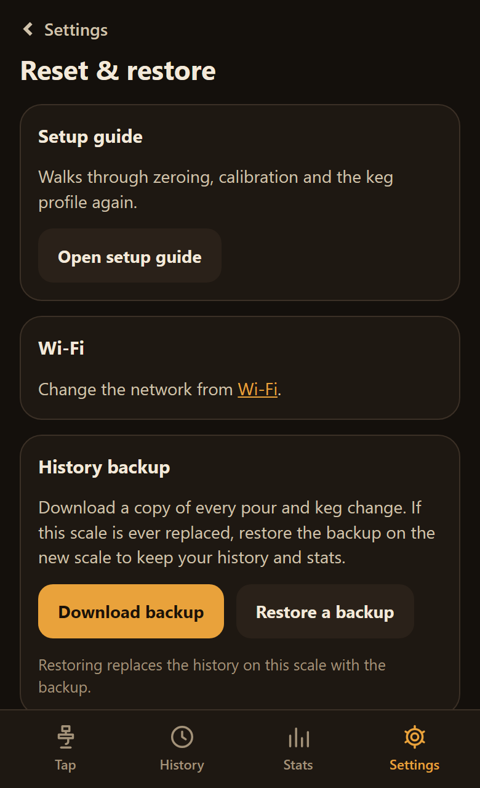
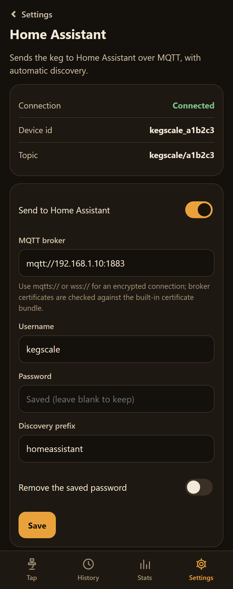

# KegScale Installation & User Guide

KegScale sits under your keg and tells you how much beer is left, how fast it is going, and when it will run out. It works on your home Wi-Fi with no account: open it in any phone or computer browser. Two extras are optional:

- **The KegScale app** (Android) sets the scale up over Bluetooth and shows your kegs on your phone.
- **KegScale Cloud** lets you check your kegs away from home, get phone alerts, share a scale with friends, and keep a copy of your history off the scale.

Setup takes about 15 minutes.

**Contents:** [You will need](#you-will-need) · [1. Place and power](#step-1-place-and-power-the-scale) · [2. Wi-Fi](#step-2-connect-to-wi-fi) · [3. Calibrate](#step-3-calibrate-the-scale) · [4. Your keg](#step-4-set-up-your-keg) · [5. Display or touchscreen](#step-5-optional-pair-a-display-or-touchscreen) · [Using KegScale](#using-kegscale) · [The KegScale app](#the-kegscale-app) · [KegScale Cloud](#kegscale-cloud) · [Replacing a scale](#replacing-a-scale) · [Home Assistant](#home-assistant-optional) · [Updates and security](#updates-and-security) · [Troubleshooting](#troubleshooting)

## You will need

- Your KegScale, its USB cable and a USB wall adapter
- A 2.4 GHz Wi-Fi network and its password (KegScale cannot join 5 GHz-only networks)
- A phone, tablet or computer with a web browser
- Something of known weight for calibration, 5 lb or more: a dumbbell, a bag of flour, a full 12-pack (about 9.5 lb)
- Your keg, and its empty weight if you know it (it is usually stamped on the keg; you can also weigh it on the scale when empty)

**Optional:**

- An Android phone with the KegScale app (see [The KegScale app](#the-kegscale-app)). There is no iPhone app yet; iPhone users use the browser.
- The KegScale e-Ink display or a touchscreen. Both are covered in Step 5.

## Step 1: Place and power the scale

Put the scale on a hard, level floor or shelf where the keg will live, then plug it in. Leave the keg off for now: you will zero and calibrate the empty scale first.

1. Choose a flat, solid surface. Carpet, a warped kegerator floor or a rocking shelf will make readings drift.
2. Make sure only the scale's feet touch the floor and nothing else (walls, beer lines, the kegerator door) leans on the top plate.
3. Keep it within good Wi-Fi range. Inside a metal kegerator the signal is weaker, so try the setup near where it will finally sit.
4. Plug the scale into a USB wall adapter. The scale starts in about 10 seconds.

A brand-new scale has no Wi-Fi saved, so it waits to be set up. Go to Step 2.

The scale holds up to **200 lb**, enough for a full half-barrel keg (about 160 lb) with room to spare. Do not stand on it or load it past 200 lb.

## Step 2: Connect to Wi-Fi

There are two ways. Use the app if you have it; otherwise use the setup network, which works with any phone or computer.

### With the KegScale app (Bluetooth)

1. Turn on Bluetooth on your phone and stand within a few metres of the scale.
2. In the app, tap **+** (Add a scale). Under **New scale**, your scale shows as **KegScale-XXXX · Needs Wi-Fi**. Tap it.
3. Pick your home Wi-Fi from the list the scale found (tap **Scan again** if it is missing, or **Other network** for a hidden one) and enter the password. The password is encrypted between the phone and the scale.
4. If you are signed in to KegScale Cloud, leave **Link to KegScale Cloud** on to link the scale at the same time.
5. Tap **Join this network**. The scale tests the password before saving it, then joins your network. Tap **Open the scale**.

### With the setup network (any phone or computer)

The scale broadcasts a setup network named **KegScale-Setup-XXXX** (the last four characters are unique to your scale).

1. On your phone, open Wi-Fi settings and join **KegScale-Setup-XXXX**. It has no password.
2. A setup page should open by itself. If it does not, open a browser and go to http://192.168.4.1. Some phones show "No internet" on this network; choose to stay connected.
3. Choose your home Wi-Fi from the list. If it is hidden, tap **Network not listed?** and type the name.
4. Enter the Wi-Fi password and tap **Save & Connect**. The scale restarts and joins your network.
5. Reconnect your phone to your normal Wi-Fi.

**Finding the scale afterwards**

- In the app, tap **+**: scales already on your Wi-Fi are listed under **Already on your Wi-Fi**.
- In a browser, open **http://KegScale-XXXX.local** (same four characters as the setup network).
- If `.local` names do not work on your device (some Android phones), find the scale's address in your router's list of connected devices; it shows as **KegScale-XXXX**. Then open `http://<that address>`.
- Bookmark the page or add it to your home screen.

If the scale cannot reach your Wi-Fi when it starts (wrong password, router off), it goes back into setup so you can fix it, and keeps retrying your saved network every 5 to 30 minutes. A router that is just slow to come back after a power cut needs no action.

**Tip:** the setup page also has **Setup mode > Calibrate scale**, which lets you calibrate before joining Wi-Fi. Most people calibrate later, in Step 3.

## Step 3: Calibrate the scale

Calibration teaches the scale what a pound is, using an object you know the weight of. Do it once now; it is saved through restarts and updates.

Open the scale in your browser, go to **Settings > Setup guide**, and follow steps 1 and 2 (in the app: open the scale, **Manage > Calibrate**):

1. **Zero the empty scale.** Take everything off the scale, including the keg. Wait for the reading to say *steady*, then tap **Zero now**.
2. **Calibrate.** Put your known weight in the centre of the scale, wait for *steady*, enter its weight in pounds, and tap **Save calibration**.
3. **Check it.** Lift the weight off: the reading should return to about 0.00. Put it back: it should show the known weight.

The heavier and more exact your reference weight, the better: a 20 lb dumbbell beats a 12-pack. You can redo this any time under **Settings > Calibration**. Zeroing with something still on the scale makes every reading wrong, so always zero it empty. Calibrating needs you at the scale: the app only offers it when the phone is on the same Wi-Fi.

## Step 4: Set up your keg

Step 3 of the setup guide describes the keg so the scale can turn weight into beer left. Set the keg on the scale, fill in the form, and tap **Save and continue**. In the app, open the scale and tap **Set up the keg**.

| Field | What to enter |
| --- | --- |
| Beer name | What is on tap, up to 32 characters |
| Keg size | Half barrel (15.5 gal), Quarter barrel (7.75), Sixth barrel (5.17), Corny keg (5) or Custom |
| Serving size | Can 12 oz, Pint 16 oz, Cup 20 oz, Crowler 32 oz, Growler 64 oz, or any size in ounces |
| Empty keg weight (lb) | The tare weight stamped on the keg, or put the empty keg on the scale and tap **Use scale** |
| Beer density (lb per gallon) | Leave at 8.34 unless you know better; most beers are 8.3 to 8.6 |

After you save, leave the keg alone for about a minute. The scale waits for the weight to settle before it starts counting pours, so setting the keg down is not counted as beer poured. Small changes under about 4 oz are treated as drift, not pours.

**Replacing a scale?** The last step of the setup guide links to **Restore a backup**. See [Replacing a scale](#replacing-a-scale).

**Changing kegs later:** use **Settings > Replace keg** on the scale's page, or **Change keg** in the app. Both walk you through lifting the old keg and setting the new one, and start fresh counts for the new keg. Your history from earlier kegs is kept.

Changing the serving size later (say pints to cans) only changes how servings are shown; the ounces already recorded stay the same.

## Step 5 (optional): Pair a display or touchscreen

Each pairing takes about a minute and uses a 6-digit code so a neighbour's scale can never grab your display. The pairing window stays open for 5 minutes.

**E-Ink display** (battery display by the tap, talks to the scale over Bluetooth)

1. Keep the display within a few metres of the scale for pairing.
2. On the scale, open **Settings > E-ink display** and tap **Pair a display**. If the scale has Bluetooth off (see below), it restarts first, which takes about 20 seconds, and then opens pairing.
3. Touch the display to wake it. It finds the scale and shows a 6-digit code.
4. Type the code on the scale page and tap **Pair**.

5. On the same page choose what it shows: servings or percent left, beer name, gallons, serving size. The **preview** shows exactly what the display will look like with your keg's numbers before you save. Changes reach the display at its next check-in.

The display checks in every 3 minutes and whenever you touch it. To save battery, turn off **Check in every 3 minutes**: it then checks in once an hour, plus when touched.

**Bluetooth on the scale.** Bluetooth is only needed for Wi-Fi setup and the e-Ink display, and it uses a lot of the scale's memory. With the setting on **Auto** (the default), the scale turns Bluetooth on for setup and while a display is paired, and off otherwise. You can change this under **Settings > E-ink display > Bluetooth**; changing it restarts the scale. The touchscreen, the app on Wi-Fi, Home Assistant and Cloud do not need Bluetooth.

**Touchscreen** (Wi-Fi screen that shows the keg)

1. Connect the touchscreen to the same Wi-Fi network as the scale.
2. On the scale, open **Settings > Touchscreen** and tap **Pair a touchscreen**.
3. On the touchscreen, go to its Setup and choose this scale. It shows a code.
4. Enter the code on the scale page and tap **Approve**.

To move a touchscreen to another scale, remove the pairing on both sides: on the scale page and in the touchscreen's Setup.

## Using KegScale

The scale's web page has four tabs: **Tap** (what is left), **History** (every pour), **Stats** (totals and fun numbers) and **Settings**. On a phone they sit along the bottom; on a computer, down the side.

**Tap views.** Tap **View** on the Tap page to pick how the level is shown. Each view has its own link (for example `/#big`), handy for a wall tablet.

| View | Best for |
| --- | --- |
| Keg | The everyday default |
| Glass | Fills by serving: can, cup, pint, crowler or growler |
| Gauge | A regulator-style dial |
| Big number | Reading from across the room |
| Tap list | Guests: what is on tap |
| Service | Every number at once |

**History.** Every pour is logged with its size and time, along with keg changes. You get pours this keg, an estimated empty date, a pour-size breakdown, busiest day, fastest kick, milestones and more. Events the scale could not call a pour are labelled, for example *Weight added* (something set on the keg), *Large removal* or *Keg removed* and *Keg returned* (the keg lifted and put back). If a line is wrong, you can remove it; clearing offers this keg, today, or everything.

**Replacing a keg.** Use **Settings > Replace keg** when a keg kicks. With the empty keg still on the scale it saves the keg's real empty weight, then walks you through swapping kegs and starts a new keg in History.

**Theme.** **Settings > Appearance** switches between Stout (dark), Pale ale (light) or your device's setting. This is saved per browser.

**Help.** **Settings > Help** links to this guide and to email support.

## The KegScale app

The app is free and works at home with no account. It is in testing on Google Play for Android; to join, email support (address at the end of this guide) with the Google account you use on your phone, and you will get an invitation. There is no iPhone app yet.

**Adding scales.** Tap **+** (Add a scale). The app looks for scales two ways at once: over Bluetooth for new scales that need Wi-Fi, and across your Wi-Fi for scales already set up. Tap a scale under **Already on your Wi-Fi** to add it, or type its address. If the scale has a PIN (see [Updates and security](#updates-and-security)), the app asks for it once.

**The app's tabs.**

| Tab | What it shows |
| --- | --- |
| Taps | Every keg at a glance, as cards, a tap list or tiles. Tap a keg for its details. |
| History | Pours and keg changes from all your scales on one timeline |
| Settings | Your KegScale Cloud account, add a scale, vibration, phone notifications, privacy policy, app version |

**One scale.** Tap a keg to open it. It has four sections:

- **Overview:** the level as a keg, glass, gauge or big number, with servings and gallons left and the estimated empty date. **Change keg** starts the new-keg steps.
- **History** and **Stats:** the same pours and numbers as the scale's own page.
- **Manage:** the keg profile, sharing and alerts (with Cloud), **Calibrate**, firmware updates, the scale's network address, **Web page** (opens the scale's own page in your browser), and **Link to KegScale Cloud**.

**At home and away.** When your phone is on the same Wi-Fi as the scale, the app talks straight to it. Away from home, the app shows what the scale last sent to KegScale Cloud, if it is linked. Calibrating needs you at home; changing the keg and checking for updates also work away from home through Cloud.

**App updates.** When a new version is on Google Play, a card at the top of **Taps** says so. Tap **Update**; it downloads while you keep using the app, then tap **Restart now**.

## KegScale Cloud

KegScale Cloud is optional. Your scale keeps working at home without it. With it you can:

- check your kegs from anywhere in the app;
- get phone alerts: running low, keg taken off, new keg, scale offline, or every pour;
- share a scale with friends, family or housemates;
- keep a copy of your pour history off the scale.

**During testing, Cloud is free.** You need a license key from support to turn it on.

**1. Sign in.** In the app, go to **Settings > Sign in to KegScale Cloud**. Enter your email and tap **Email me a code**, then enter the 6-digit code from the email (it lasts 10 minutes). There is no password. After signing in, the app goes back to your taps.

**2. Add your license key.** In the app's **Settings**, tap your email address at the top, then enter the key (it looks like `KEG-XXXX-XXXX-XXXX`) under **License key** and tap **Add key**. The account page shows how long Cloud is active and how many scales you can link. Adding another key adds its time to your account.

**3. Link the scale.**

- **New scale:** set it up over Bluetooth with **Link to KegScale Cloud** left on (Step 2). It links as soon as it is online.
- **Scale already on Wi-Fi:** with your phone on the same Wi-Fi, open the scale in the app and tap **Manage > Link to KegScale Cloud**. It shows as linked after its first check-in, within a few seconds.

The scale's own page shows the link under **Settings > KegScale Cloud**: its status, the last check-in, **Check in now** and **Unlink**. The scale checks in every few minutes, and every minute while someone has it open in the app.

**Alerts.** Open the scale in the app, then **Manage > Alerts**. Choose a **Running low** level (sent once per keg) and turn on the alerts you want. The first time, Android asks whether KegScale may send notifications: allow it.

**Sharing a scale.** Only the scale's owner can share it. Open the scale, then **Manage > Sharing**, enter the person's email and tap **Invite**. Everyone you share with sees the keg level, history and alerts. You can also let them:

| Permission | What it allows |
| --- | --- |
| Change the keg | Beer name, size and serving size, from anywhere; start a new keg |
| Calibrate | Zero and calibrate the scale, at the scale |
| Change settings | Display layout, history clean-up and update checks |

The person gets an invitation email. The link in it opens the app, or the Play Store if they don't have it yet. They must sign in with **the same email address the invitation was sent to**, then tap **Accept**. People you share with don't need their own license key. You can change their permissions or tap **Stop sharing** at any time; they can also leave with **Stop seeing this scale**.

**Unlinking and leaving.** **Manage > Unlink from KegScale Cloud** stops the scale checking in; its history stays in your account, read-only. **Remove from this phone** only removes it from the app. To delete your account and everything in it, open your account page in the app and use **Delete account**.

**If your Cloud time runs out**, the scale keeps working at home and in the app on your Wi-Fi. Its Cloud page shows **Paused** and it checks in only once a day until you add a new key; your history in Cloud is kept.

## Replacing a scale

Your pour history can move to a new scale, so a replacement keeps every pour, keg and stat.

1. **Download a backup now, while the scale works.** Open **Settings > Reset & restore > History backup** and tap **Download backup**. Keep the `.kegh` file somewhere safe, and download a fresh one now and then. A scale that has failed completely cannot hand over its history.
2. **Set up the new scale** (Steps 1 to 4).
3. **Restore.** On the new scale, open **Settings > Reset & restore**, tap **Restore a backup** and choose the file. The scale shows which scale the file came from and when it was made; confirm to restore.

Restoring **replaces** the new scale's history with the backup, so do it right after setup. A damaged or wrong file is refused and nothing is changed. The backup holds history only: enter the keg profile and calibrate the new scale as usual.

If the old scale was linked to KegScale Cloud, its history stays in your account. Unlink the old scale in the app and link the new one; contact support if you need the Cloud copy of the history moved onto the new scale.

## Home Assistant (optional)

KegScale sends its readings to Home Assistant over MQTT and appears there automatically as a device; no YAML is needed. You need an MQTT broker, such as the Mosquitto add-on in Home Assistant.

1. In Home Assistant, install the Mosquitto broker and the MQTT integration if you do not already use them, and create a user for the scale.
2. On the scale, open **Settings > Home Assistant** and turn on **Send to Home Assistant**.
3. Enter the broker address, for example `mqtt://192.168.1.10:1883`, and the username and password. Use `mqtts://` or `wss://` for an encrypted connection.
4. Leave **Discovery prefix** as `homeassistant` unless you changed it in Home Assistant, then tap **Save**.
5. The status should change to **Connected**, and a KegScale device appears under **Settings > Devices & services > MQTT**.

| Group | Entities |
| --- | --- |
| Keg level | Servings Remaining, Remaining (%), Gallons Remaining, Beer Weight, Scale Weight |
| Pours | Servings (24 h), Servings (7 days), Pours This Keg, Last Pour, Last Pour Time, Keg Tapped, Estimated Empty |
| Activity | Keg Activity event: pour, new_keg, keg_removed, keg_returned, with volume and servings |
| Keg setup | Beer Name, Empty Keg Weight, Serving Size, Beer Name at Top |
| Calibration | Calibrated, Tare Set, Stable, and buttons to Tare, Calibrate, Capture Empty Keg Weight and Clear calibration |
| Device | Wi-Fi Signal, IP Address, Firmware Compatibility |

The **Keg Activity** event is the one to use for automations, for example a notification when a new keg is tapped or when Estimated Empty is under two days away.

## Updates and security

**Scale updates install themselves.** Your scale checks for signed firmware updates and installs them automatically; it restarts once, in about 30 seconds, and keeps your settings and history. An update can arrive at any time, so a pour made during that restart may not be counted. Paired e-Ink displays are updated the same way. You can see versions, check now, or turn automatic updates off under **Settings > Updates** on the scale's page, or **Manage > Firmware updates** in the app (owner only).

Leave the channel on **Production**. Beta gets new features earlier; Development is experimental and can be unstable.

**App updates** come from Google Play; see [The KegScale app](#the-kegscale-app).

**Optional PIN.** By default anyone on your home network can open the scale's pages. To lock the settings, open **Settings > Security** and set a PIN of 6 to 12 digits. Every page then asks for it, and you stay signed in until 30 minutes of inactivity. The app asks for the PIN once per phone. The pages use plain HTTP on your local network, so the PIN keeps others out but does not encrypt traffic.

If you forget the PIN, it can only be cleared through the scale's USB connection; contact support.

**KegScale Cloud** uses encrypted connections (HTTPS) between the scale, the app and the Cloud. Cloud sign-in uses one-time email codes, so there is no password to leak. The privacy policy is linked from the app's **Settings**.

## Troubleshooting

Most problems are fixed by one of the steps below. If not, send support a bundle (last row).

| Problem | What to do |
| --- | --- |
| Can't find the scale's page | In the app, tap **+** and look under **Already on your Wi-Fi**. In a browser, try `http://KegScale-XXXX.local`, or look up its address in your router's device list. Phone and scale must be on the same network. |
| The app doesn't find a new scale | Turn on Bluetooth and allow the app's Bluetooth (Nearby devices) permission, stand within a few metres, and tap **Look again**. A new scale shows up only until it has Wi-Fi. You can always use the setup network instead (Step 2). |
| The app doesn't find a scale on Wi-Fi | Make sure the phone is on the same Wi-Fi as the scale (not mobile data or a guest network). Or type its address under **Or enter its address**. |
| New router or Wi-Fi password | If the scale can't connect at start-up, it goes back into setup: use the app or the **KegScale-Setup-XXXX** network (Step 2). Still on the old Wi-Fi? **Settings > Wi-Fi > Forget Wi-Fi and restart**. Calibration and keg settings are kept. |
| Readings drift or jump | Check nothing touches the top plate and the surface is level and solid. Then redo **Settings > Calibration**. |
| Beer left looks wrong | Check the keg size and empty keg weight under **Settings > Keg profile**. After a keg change, use **Replace keg** (or **Change keg** in the app). |
| A pour was missed or a wrong event logged | Remove the line in **History**. Things set on or lifted off the keg show as Weight added, Large removal, or Keg removed and returned. |
| E-Ink display shows Offline | Touch it to wake it; it reconnects at that check-in. Moving it closer to the scale helps. Check that the scale's Bluetooth setting is not **Off**. |
| E-Ink pairing or removal is stuck | **Settings > E-ink display > Reset pairing**. If the display still shows the old pairing, power-cycle it three times quickly to clear its side, then pair again. |
| Touchscreen won't pair again | Remove the pairing on both the scale page and the touchscreen's Setup, then pair again (Step 5). |
| No sign-in code email | Check spam, and that the address is typed correctly. Codes last 10 minutes; tap **Email me a code** again for a new one. |
| Invitation says it's for another email | Sign out in the app, then sign in with the address the invitation was sent to. Or ask the owner to invite the address you use. |
| Away from home, the keg isn't updating | Check the scale is linked (**Manage > KegScale Cloud**, or **Settings > KegScale Cloud** on the scale's page) and that the last check-in is recent. **Paused** means your Cloud time has run out: add a license key. |
| No alerts on the phone | Check **Manage > Alerts** for that scale, and that notifications for KegScale are allowed in Android settings. Alerts need the scale linked to Cloud. |
| Forgot the PIN | It can only be cleared over the scale's USB connection; contact support. |
| Scale replaced | Restore your history backup on the new scale ([Replacing a scale](#replacing-a-scale)). |
| Start completely over | **Settings > Reset & restore > Factory reset** (type RESET). It erases Wi-Fi, calibration, keg profile, pairings, Home Assistant, the Cloud link and the PIN, then restarts into setup. Pour history is kept. |
| Anything else | **Settings > Diagnostics > Download support bundle** and send it to support. If a **Crash report** shows there, download it too. |

**Support:** email <perry.khris+kegsupport@gmail.com> and attach the support bundle if you can.
