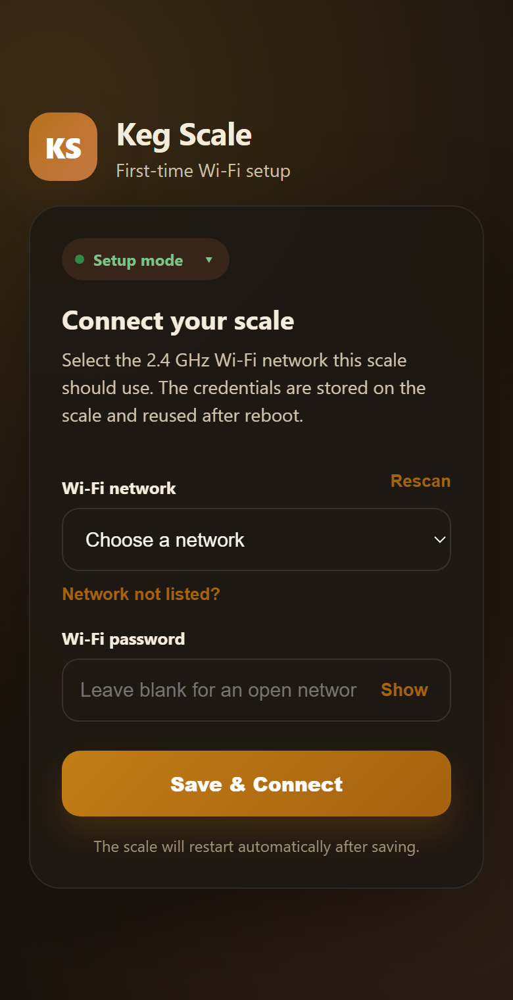
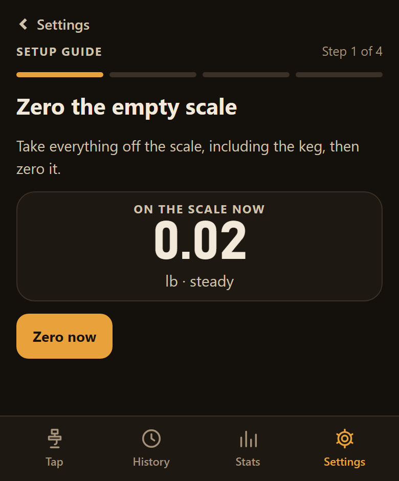
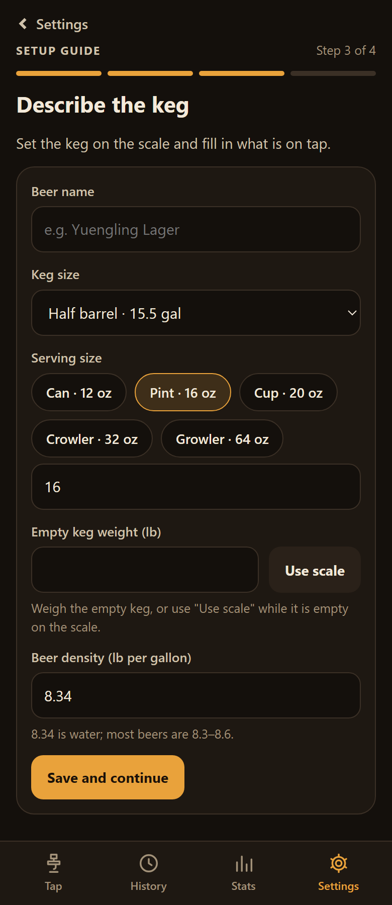
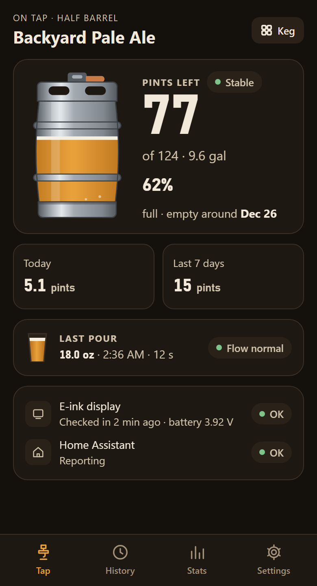

# KegScale Installation & User Guide

KegScale sits under your keg and tells you how much beer is left, how fast it is going, and when it will run out. It works on your home Wi-Fi with no account or app: you open it in any phone or computer browser. Setup takes about 15 minutes.

**Contents:** [You will need](#you-will-need) · [1. Place and power](#step-1-place-and-power-the-scale) · [2. Wi-Fi](#step-2-connect-to-wi-fi) · [3. Calibrate](#step-3-calibrate-the-scale) · [4. Your keg](#step-4-set-up-your-keg) · [5. Display or touchscreen](#step-5-optional-pair-a-display-or-touchscreen) · [Using KegScale](#using-kegscale) · [Replacing a scale](#replacing-a-scale) · [Home Assistant](#home-assistant-optional) · [Updates and security](#updates-and-security) · [Troubleshooting](#troubleshooting)

## You will need

- Your KegScale, its USB cable and a USB wall adapter
- A 2.4 GHz Wi-Fi network and its password (KegScale cannot join 5 GHz-only networks)
- A phone, tablet or computer with a web browser
- Something of known weight for calibration, 5 lb or more: a dumbbell, a bag of flour, a full 12-pack (about 9.5 lb)
- Your keg, and its empty weight if you know it (it is usually stamped on the keg; you can also weigh it on the scale when empty)

**Optional extras** that pair with the scale: the KegScale e-Ink display and a touchscreen. Both are covered in Step 5.

## Step 1: Place and power the scale

Put the scale on a hard, level floor or shelf where the keg will live, then plug it in. Leave the keg off for now: you will zero and calibrate the empty scale first.

1. Choose a flat, solid surface. Carpet, a warped kegerator floor or a rocking shelf will make readings drift.
2. Make sure only the scale's feet touch the floor and nothing else (walls, beer lines, the kegerator door) leans on the top plate.
3. Keep it within good Wi-Fi range. Inside a metal kegerator the signal is weaker, so try the setup near where it will finally sit.
4. Plug the scale into a USB wall adapter. The scale starts in about 10 seconds.

A brand-new scale has no Wi-Fi saved, so it starts its own setup network. Go to Step 2.

The scale holds up to **200 lb**, enough for a full half-barrel keg (about 160 lb) with room to spare. Do not stand on it or load it past 200 lb.

## Step 2: Connect to Wi-Fi

The scale broadcasts a setup network named **KegScale-Setup-XXXX** (the last four characters are unique to your scale). Join it with your phone and pick your home network.

1. On your phone, open Wi-Fi settings and join **KegScale-Setup-XXXX**. It has no password.
2. A setup page should open by itself. If it does not, open a browser and go to http://192.168.4.1. Some phones show "No internet" on this network; choose to stay connected.
3. Choose your home Wi-Fi from the list. If it is hidden, tap **Network not listed?** and type the name.
4. Enter the Wi-Fi password and tap **Save & Connect**. The scale restarts and joins your network.
5. Reconnect your phone to your normal Wi-Fi.

**Finding the scale afterwards**

- On most phones and computers, open **http://KegScale-XXXX.local** (same four characters as the setup network).
- If `.local` names do not work on your device (some Android phones), find the scale's address in your router's list of connected devices; it shows as **KegScale-XXXX**. Then open `http://<that address>`.
- Bookmark the page or add it to your home screen.

If the scale cannot reach your Wi-Fi when it starts (wrong password, router off), it brings the setup network back so you can fix it, and keeps retrying your saved network every 5 to 30 minutes. A router that is just slow to come back after a power cut needs no action.

**Tip:** the setup page also has **Setup mode > Calibrate scale**, which lets you calibrate before joining Wi-Fi. Most people calibrate later, in Step 3.

## Step 3: Calibrate the scale

Calibration teaches the scale what a pound is, using an object you know the weight of. Do it once now; it is saved through restarts and updates.

Open the scale in your browser, go to **Settings > Setup guide**, and follow steps 1 and 2:

1. **Zero the empty scale.** Take everything off the scale, including the keg. Wait for the reading to say *steady*, then tap **Zero now**.
2. **Calibrate.** Put your known weight in the centre of the scale, wait for *steady*, enter its weight in pounds, and tap **Save calibration**.
3. **Check it.** Lift the weight off: the reading should return to about 0.00. Put it back: it should show the known weight.

The heavier and more exact your reference weight, the better: a 20 lb dumbbell beats a 12-pack. You can redo this any time under **Settings > Calibration**. Zeroing with something still on the scale makes every reading wrong, so always zero it empty.

## Step 4: Set up your keg

Step 3 of the setup guide describes the keg so the scale can turn weight into beer left. Set the keg on the scale, fill in the form, and tap **Save and continue**.

| Field | What to enter |
| --- | --- |
| Beer name | What is on tap, up to 32 characters |
| Keg size | Half barrel (15.5 gal), Quarter barrel (7.75), Sixth barrel (5.17), Corny keg (5) or Custom |
| Serving size | Can 12 oz, Pint 16 oz, Cup 20 oz, Crowler 32 oz, Growler 64 oz, or any size in ounces |
| Empty keg weight (lb) | The tare weight stamped on the keg, or put the empty keg on the scale and tap **Use scale** |
| Beer density (lb per gallon) | Leave at 8.34 unless you know better; most beers are 8.3 to 8.6 |

After you save, leave the keg alone for about a minute. The scale waits for the weight to settle before it starts counting pours, so setting the keg down is not counted as beer poured.

**Replacing a scale?** The last step of the setup guide links to **Restore a backup**. See [Replacing a scale](#replacing-a-scale).

**Changing kegs later:** use **Settings > Replace keg**. It walks you through lifting the old keg, setting the new one, and starts fresh counts for the new keg. Your history from earlier kegs is kept.

Changing the serving size later (say pints to cans) only changes how servings are shown; the ounces already recorded stay the same.

## Step 5 (optional): Pair a display or touchscreen

Each pairing takes about a minute and uses a 6-digit code so a neighbour's scale can never grab your display. The pairing window stays open for 5 minutes.

**E-Ink display** (battery display by the tap, talks to the scale over Bluetooth)

1. Keep the display within a few metres of the scale for pairing.
2. On the scale, open **Settings > E-ink display** and tap **Pair a display**.
3. Touch the display to wake it. It finds the scale and shows a 6-digit code.
4. Type the code on the scale page and tap **Pair**.

5. On the same page choose what it shows: servings or percent left, beer name, gallons, serving size. The **preview** shows exactly what the display will look like with your keg's numbers before you save. Changes reach the display at its next check-in.

The display checks in every 3 minutes and whenever you touch it. To save battery, turn off **Check in every 3 minutes**: it then checks in once an hour, plus when touched.

**Touchscreen** (Wi-Fi screen that shows the keg)

1. Connect the touchscreen to the same Wi-Fi network as the scale.
2. On the scale, open **Settings > Touchscreen** and tap **Pair a touchscreen**.
3. On the touchscreen, go to its Setup and choose this scale. It shows a code.
4. Enter the code on the scale page and tap **Approve**.

To move a touchscreen to another scale, remove the pairing on both sides: on the scale page and in the touchscreen's Setup.

## Using KegScale

The scale's web page has four tabs: **Tap** (what is left), **History** (every pour), **Stats** (totals and fun numbers) and **Settings**. On a phone they sit along the bottom; on a computer, down the side.

**Tap views.** Tap **View** on the Tap page to pick how the level is shown. Each view has its own link (for example `/#big`), handy for a wall tablet.

| View | Best for |
| --- | --- |
| Keg | The everyday default |
| Glass | Fills by serving: can, cup, pint, crowler or growler |
| Gauge | A regulator-style dial |
| Big number | Reading from across the room |
| Tap list | Guests: what is on tap |
| Service | Every number at once |

**History.** Every pour is logged with its size and time, along with keg changes. You get pours this keg, an estimated empty date, a pour-size breakdown, busiest day, fastest kick, milestones and more. Events the scale could not call a pour are labelled, for example *Weight added* (something set on the keg), *Large removal* or *Keg removed* and *Keg returned* (the keg lifted and put back). If a line is wrong, you can remove it; clearing offers this keg, today, or everything.

**Replacing a keg.** Use **Settings > Replace keg** when a keg kicks. With the empty keg still on the scale it saves the keg's real empty weight, then walks you through swapping kegs and starts a new keg in History.

**Theme.** **Settings > Appearance** switches between Stout (dark), Pale ale (light) or your device's setting. This is saved per browser.

**Help.** **Settings > Help** links back to this guide and to email support.

## Replacing a scale

Your pour history can move to a new scale, so a replacement keeps every pour, keg and stat.

1. **Download a backup now, while the scale works.** Open **Settings > Reset & restore > History backup** and tap **Download backup**. Keep the `.kegh` file somewhere safe, and download a fresh one now and then. A scale that has failed completely cannot hand over its history.
2. **Set up the new scale** (Steps 1 to 4).
3. **Restore.** On the new scale, open **Settings > Reset & restore**, tap **Restore a backup** and choose the file. The scale shows which scale the file came from and when it was made; confirm to restore.

Restoring **replaces** the new scale's history with the backup, so do it right after setup. A damaged or wrong file is refused and nothing is changed. The backup holds history only: enter the keg profile and calibrate the new scale as usual.

## Home Assistant (optional)

KegScale sends its readings to Home Assistant over MQTT and appears there automatically as a device; no YAML is needed. You need an MQTT broker, such as the Mosquitto add-on in Home Assistant.

1. In Home Assistant, install the Mosquitto broker and the MQTT integration if you do not already use them, and create a user for the scale.
2. On the scale, open **Settings > Home Assistant** and turn on **Send to Home Assistant**.
3. Enter the broker address, for example `mqtt://192.168.1.10:1883`, and the username and password. Use `mqtts://` or `wss://` for an encrypted connection.
4. Leave **Discovery prefix** as `homeassistant` unless you changed it in Home Assistant, then tap **Save**.
5. The status should change to **Connected**, and a KegScale device appears under **Settings > Devices & services > MQTT**.

| Group | Entities |
| --- | --- |
| Keg level | Servings Remaining, Remaining (%), Gallons Remaining, Beer Weight, Scale Weight |
| Pours | Servings (24 h), Servings (7 days), Pours This Keg, Last Pour, Last Pour Time, Keg Tapped, Estimated Empty |
| Activity | Keg Activity event: pour, new_keg, keg_removed, keg_returned, with volume and servings |
| Keg setup | Beer Name, Empty Keg Weight, Serving Size, Beer Name at Top |
| Calibration | Calibrated, Tare Set, Stable, and buttons to Tare, Calibrate, Capture Empty Keg Weight and Clear calibration |
| Device | Wi-Fi Signal, IP Address, Firmware Compatibility |

The **Keg Activity** event is the one to use for automations, for example a notification when a new keg is tapped or when Estimated Empty is under two days away.

## Updates and security

**Updates install themselves.** Your scale checks for signed firmware updates and installs them automatically; it restarts once, in about 30 seconds, and keeps your settings and history. An update can arrive at any time, so a pour made during that restart may not be counted. Paired e-Ink displays are updated the same way. You can see versions, check now, or turn automatic updates off under **Settings > Updates**.

Leave the channel on **Production**. Beta gets new features earlier; Development is experimental and can be unstable.

**Optional PIN.** By default anyone on your home network can open the scale's pages. To lock the settings, open **Settings > Security** and set a PIN of 6 to 12 digits. Every page then asks for it, and you stay signed in until 30 minutes of inactivity. The pages use plain HTTP on your local network, so the PIN keeps others out but does not encrypt traffic.

If you forget the PIN, it can only be cleared through the scale's USB connection; contact support.

## Troubleshooting

Most problems are fixed by one of the steps below. If not, send support a bundle (last row).

| Problem | What to do |
| --- | --- |
| Can't find the scale's page | Try `http://KegScale-XXXX.local`, or look up its address in your router's device list. Phone and scale must be on the same network. |
| New router or Wi-Fi password | If the scale can't connect at start-up, the **KegScale-Setup-XXXX** network comes back: join it and pick the new network (Step 2). Still on the old Wi-Fi? **Settings > Wi-Fi > Forget Wi-Fi and restart**. Calibration and keg settings are kept. |
| Readings drift or jump | Check nothing touches the top plate and the surface is level and solid. Then redo **Settings > Calibration**. |
| Beer left looks wrong | Check the keg size and empty keg weight under **Settings > Keg profile**. After a keg change, use **Replace keg**. |
| A pour was missed or a wrong event logged | Remove the line in **History**. Things set on or lifted off the keg show as Weight added, Large removal, or Keg removed and returned. |
| E-Ink display shows Offline | Touch it to wake it; it reconnects at that check-in. Moving it closer to the scale helps. |
| E-Ink pairing or removal is stuck | **Settings > E-ink display > Reset pairing**. If the display still shows the old pairing, power-cycle it three times quickly to clear its side, then pair again. |
| Touchscreen won't pair again | Remove the pairing on both the scale page and the touchscreen's Setup, then pair again (Step 5). |
| Forgot the PIN | It can only be cleared over the scale's USB connection; contact support. |
| Scale replaced | Restore your history backup on the new scale ([Replacing a scale](#replacing-a-scale)). |
| Start completely over | **Settings > Reset & restore > Factory reset** (type RESET). It erases Wi-Fi, calibration, keg profile, pairings, Home Assistant and the PIN, then restarts into setup. Pour history is kept. |
| Anything else | **Settings > Diagnostics > Download support bundle** and send it to support. If a **Crash report** shows there, download it too. |

**Support:** email <perry.khris+kegsupport@gmail.com> and attach the support bundle if you can.
